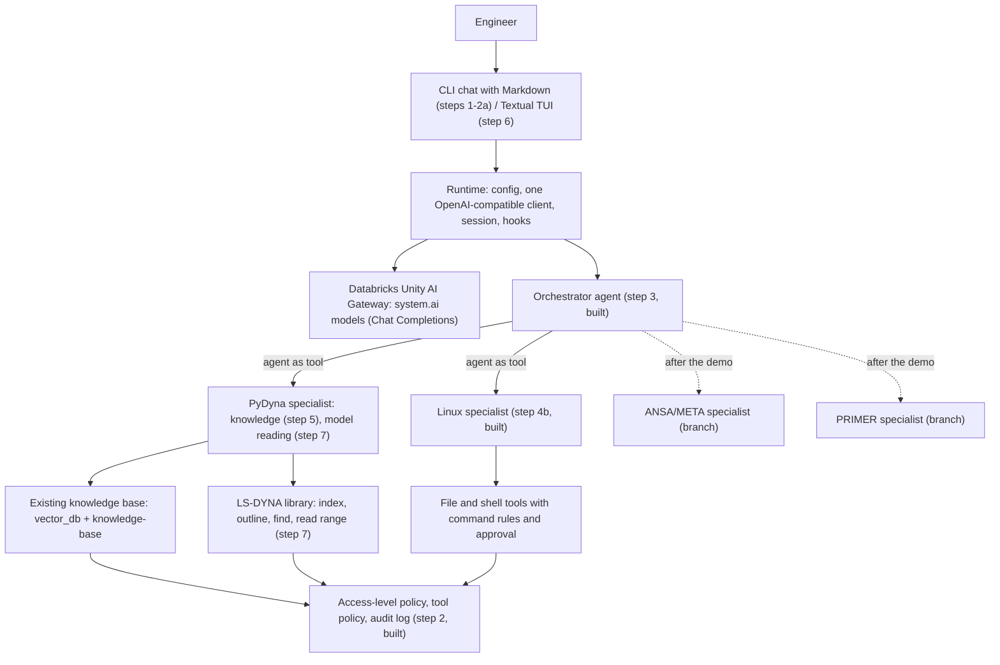

# Champion - Project Report

Author: Manoj Malavkar. Repository: https://github.com/ManojMalavkar/Champion

This report is updated at the end of every build step. It is written to be presented: summary first, then architecture, decisions, safety, progress with evidence, a demo script and likely questions.

**Status:** steps 0-3, 4a, 4b and 4e built (fast demo order: 4c, 4d, 5-7 and "demo ready" next): configuration and health check, first agent in a plain chat, access levels with read-only file tools and an audit log, models through the Databricks Unity AI Gateway, Markdown answers in the terminal, orchestrator with a specialist plug-in interface (agents as tools), the safe Linux tool layer (search, streaming edits with undo, command policy, safe executor, approval for deletes), the first real specialist, Linux, using it, and per-folder access (read or edit per folder, chosen by the user with `/access`). 209 automated tests (208 run on Databricks serverless; 1 needs the full local install); steps 0-3 and 4b checked live against the workspace AI Gateway, 4e live check pending on the Linux machine.

---

## 1. Summary

Champion is a multi-agent assistant for CAE (crash simulation) engineers. It answers LS-DYNA and PyDyna questions from a curated knowledge base, inspects and edits very large LS-DYNA models (mostly over 1 GB) without loading them whole, and runs generated PyDyna code only after review and user approval. It also helps with Linux tasks on the engineer's workstation.

It is a rebuild of my earlier projects, mChampion (a Textual terminal UI multi-agent assistant) and PyDyna_Agent (an LS-DYNA copilot with retrieval over ChromaDB), on the **OpenAI Agents SDK**. The goal is a cleaner architecture, a stronger safety model and a design that can take further CAE specialists (ANSA/META, PRIMER) without core changes.

## 2. Problem

* **Knowledge:** LS-DYNA has thousands of keywords with strict card formats; general LLM answers often invent parameter names or defaults.
* **Scale:** production models and their include files are often 1 to 8 GB; they cannot be pasted into a model or rewritten in one go.
* **Safety:** an assistant that reads, edits and runs code on an engineer's machine must not touch files outside what the user allowed, must not leak secrets, and must not run code that does something other than what was asked.
* **Growth:** the same assistant should later cover pre-processing tools (ANSA/META Python API, Oasys PRIMER automation).

## 3. Architecture

Built so far: CLI chat with Markdown answers, runtime on the Databricks AI Gateway, one agent with `session_info` and three read-only file tools, access levels, tool policy and audit log. Fast demo order: everything is built on `main` until the demo; after the demo, skills, MCP, model editing, code execution, the `champion kb` command and the ANSA/META and PRIMER specialists follow (agent work on branches).

Key idea: **specialists are tools, not handoffs.** The orchestrator calls `pydyna_agent` or `linux_agent` like a function and gets an answer back; it never gives up control. Each low-level tool belongs to exactly one specialist, so for example only the PyDyna agent can edit a model.

## 4. Key design decisions

| Decision | Choice | Why | Alternative considered |
| --- | --- | --- | --- |
| Agent framework | OpenAI Agents SDK | Small API (Agent, Runner, function_tool), built-in sessions, hooks, guardrails, typed outputs, tool approval | Hand-written loop (mChampion), LangGraph |
| Multi-agent pattern | Agents as tools | Orchestrator keeps control and context; each specialist has a narrow tool set; easy to test | Handoffs (control moves to the specialist, harder to keep policies central) |
| Model access | Databricks Unity AI Gateway (`system.ai` models, Claude Haiku 4.5 by default), one OpenAI-compatible client | Company-governed access (permissions, usage tracking) with no provider key; one `base_url` setting; `provider: openai` still works | Direct OpenAI key; several gateway backends (as in mChampion) |
| Build order | Fast demo order, one framework | Working demo for the interview first; safety core is plain Python, so only agent wiring would change for another framework | LangGraph/CrewAI versions (more time, little demo value) |
| Access control | An access list chosen by the user: working folder, any number of folders, everything else, each `none`, `read` or `edit`; the five levels (1.1, 1.2, 2.1, 2.2, Custom) are presets of it (step 4e) | Real work spans folders (models read-only, runs editable); presets keep it simple to explain; the longest match makes nesting predictable | Fixed levels only (step 2); mChampion's six behaviour-based levels |
| Large models | Keyword-offset index, ranged reads, patch edits | Constant memory on 1-8 GB decks; the model only ever sees small blocks | Loading the deck with PyDyna `Deck` (too slow and memory-hungry) |
| Code execution | Host run after reviewer + static check + approval + runtime guard | No container needed in phase 1; layered defence | Bubblewrap sandbox (planned as a later backend) |
| Extensibility | Specialist plug-ins with a declared spec | ANSA/META and PRIMER added without touching orchestrator, policy or UI | Hard-coded routing |
| Build process | 12 small steps, each tested, documented and committed | Every step can be demonstrated and understood | Big-bang rewrite |

## 5. Safety model

| Layer | Purpose | Status |
| --- | --- | --- |
| Secrets handling | Token read from the variable named in `llm.api_key_env` (`DATABRICKS_TOKEN`) or `.env`, never printed, not copied into the process environment; online check reports error type only | Done (steps 0, 2a), tested |
| Model governance | Only the workspace Unity AI Gateway (`/ai-gateway/...`); legacy `/serving-endpoints` URLs refused by config validation | Done (step 2a), tested |
| Tracing | SDK traces off by default (would send content to OpenAI); must stay off with the Databricks provider | Done (steps 1, 2a), tested |
| Turn limits | `max_turns` stops a looping agent; history limited to the last 10 turns | Done (step 1), tested |
| Access list | Every tool checks the per-folder list in the run context (the model cannot see or change it); only the user changes it (`--level`, `--read`, `--edit`, `--outside`, `/level`, `/access`, `champion access`); added folders are checked (exist, no link, not system or secret); wide edit asks first; each change is an audit row; saved file mode 600, ignored if others can write it | Done (steps 2, 4e), tested for all presets and nesting |
| Fixed blocks | `/proc`, `/sys`, `/dev`, `/root`, protected system files, secret-looking names (`.ssh`, `.env`, `*.pem`, tokens ...) at every level; OS folders never written | Done (step 2), tested |
| Symbolic links | Refused anywhere in a path; files opened folder by folder with `O_NOFOLLOW`, so a link swapped in after the check is still refused | Done (step 2), tested |
| Content checks | Private-key blocks refused in any file; `.key` read only if it is an LS-DYNA keyword file; binary files refused; output capped | Done (step 2), tested |
| Tool policy | Every tool declares its right; a tool without an entry cannot run (deny by default) | Done (step 2), tested |
| Audit | One row per tool call (allowed, blocked, failed) with reason; results not stored; file mode 600 | Done (step 2), tested |
| Tool ownership | Write and execute tools exist only on the specialist that needs them; a specialist is offered only if the level enables one of its tools | Done (steps 3, 4b), tested |
| Shell command rules | Argument lists only (`shell=False`); allow-list of commands and exact options; never-list with reasons (shells, interpreters, network, `sudo`, `xargs`, `awk`, HPC scheduler); wildcards expanded by Champion; every path checked as read, write or delete; options that run programs, follow links or read contents recursively refused | Done (step 4a), tested |
| Safe executor | Programs only from `/usr/bin` and `/bin`; environment of 5 variables (no tokens); own process group killed at the time limit; CPU, memory and file-size limits; output capped; private keys and tokens hidden | Done (step 4a), tested |
| Edits and deletes | Edits where the list allows edit run without a prompt and go into the session change list (`/changes`, `/undo`); deletes ask y/N every time, approval bound to a fingerprint re-checked before the start; `-q` refuses deletes | Done (step 4a), tested |
| Large-file limits | 100 MiB threshold for large-file mode, hard size limit | Step 7 (reads of 100 MiB or more already refused) |
| MCP rules | Every MCP tool has a policy entry; outbound actions (mail) always approved; web and mail content treated as data | After the demo (L2) |
| Model edits | Streaming exact-block patch with diff and undo built (step 4a, `file_edit`); LS-DYNA-aware editing on top | After the demo (L3) |
| Code review | Reviewer agent checks policy and intent; approval tied to the exact code hash | After the demo (L4) |

## 6. Progress log

### Step 0 - Skeleton, configuration, `champion doctor`
* **Built:** package layout, configuration loader (defaults + YAML, validation of every key, path resolution), `champion doctor` health check (OK/WARN/FAIL for Python, config, key, packages, paths, optional online check).
* **Evidence:** 40 tests; `champion doctor` output shows the expected failures before setup.
* **Lessons:** validate configuration once, at start, with all errors listed together; keep secrets out of the environment so child processes (code execution later) cannot inherit them.

### Step 1 - First agent in a plain chat
* **Built:** runtime (one OpenAI client, model, tracing off, session memory limited to 10 turns, turn limit), the first agent with one read-only tool `session_info`, run hooks that print every tool call, `champion chat` with `/help`, `/new`, `/usage`.
* **Evidence:** 56 tests (16 new) using a scripted fake model - no network, no cost, repeatable. Tests check the real SDK loop: the tool result goes back to the model, history is kept and trimmed, `/new` forgets, a looping agent is stopped. With an invalid key the real client reached OpenAI and the error was shown as one line (`AuthenticationError (HTTP 401)`), without key text.
* **Lessons:** the SDK replaces the hand-written tool loop from the course (lab 3) with `Runner.run`; the run context carries trusted data (like the access level) that tools use but the model never sees.
* **Issue solved:** `openai-agents` 0.24 needs `openai` 3.x, while `langchain-openai` 1.4 (course labs) needs `openai` 2.x. Solution: a dedicated virtual environment for Champion, documented in the README.

### Planning - shared foundations and agent branches
* **Decided:** shared parts (policy, plug-ins, skills, MCP, LS-DYNA library, execution, knowledge base, TUI) are built once on `main`; each agent (Linux, PyDyna, ANSA/META, PRIMER) then gets its own branch, merged by pull request, at most two open at a time. Same knowledge layout for every agent (`vector_db/` + `knowledge-base/`); ANSA, META and PRIMER (JavaScript) run in licensed batch mode.
* **Why:** no agent rebuilds shared code, branches touch separate folders (few merge conflicts), and each merge is a reviewable unit.

### Step 2 - Access levels, policy and read-only file tools
* **Built:** five access levels, fixed blocks for system and secret paths, a path check that refuses symbolic links, a tool-policy registry (deny by default), a tool guard used by every tool (policy, level, output cap, audit), an SQLite audit log, three read-only tools (`filesystem_list`, `filesystem_read`, `filesystem_disk_usage`), `champion chat --level`, and chat commands `/level` and `/audit`.
* **Evidence:** 103 tests (47 new): every level against inside/outside and read/write; links refused, including one created after the check; `.env` text never reaches the model even at level 2.2; a custom level without read hides the file tools from the model; audit rows for allowed and blocked calls. A scripted chat shows a read blocked at 1.1, `/level 2.1`, the same read allowed, `/proc` blocked at every level.
* **Lessons:** security checks belong inside the tools, not in the prompt; `is_enabled` only controls what the model sees. Refusing links is simpler and safer than resolving them. LS-DYNA's `.key` extension needs a content check instead of a name rule.

### Planning - fast demo order
* **Decided:** build by demo value for the interview: 3 orchestrator and specialist plug-ins, 4 Linux specialist, 5 PyDyna knowledge specialist on the existing knowledge base, 6 Textual TUI, 7 large-model reading, then "demo ready". One framework (OpenAI Agents SDK), everything on `main` until the demo; the rest of the roadmap (L1-L7) follows after.
* **Why:** fastest path to a convincing demo; no design is lost, only reordered.

### Step 2a - Databricks AI Gateway and Markdown answers
* **Built:**
  * `llm.provider: databricks`: models `system.ai.*` (Claude Haiku 4.5 by default, 13 more in `llm.model_ids`) through the workspace Unity AI Gateway, token in `DATABRICKS_TOKEN`.
  * The gateway path `/ai-gateway/mlflow/v1` speaks Chat Completions, so the runtime uses the SDK's `OpenAIChatCompletionsModel` for this provider (`OpenAIResponsesModel` for `openai`).
  * Config validation refuses a non-gateway URL (for example legacy `/serving-endpoints`) and tracing for this provider.
  * `champion doctor --online` sends one small request to every configured model.
  * Final answers are rendered as Markdown in a terminal (`rich`); raw text when output goes to a file or pipe, or with `champion chat --plain`. Tool lines and BLOCKED reasons stay plain.
* **Evidence:** 115 tests (12 new). Live on the workspace gateway: `champion chat -q` with Claude Haiku 4.5 called `session_info` and answered; a Markdown answer showed drawn bullets and no `**` markers in a terminal, and raw Markdown with `--plain`; `champion doctor --online`: 8 models OK, the 6 `claude-opus-*` models HTTP 403 (no permission for this user yet).
* **Lessons:** the same SDK code works with Claude and gpt-oss through an OpenAI-compatible gateway, as long as the model class matches the API (Chat Completions vs. Responses). Governance belongs in config validation: the wrong endpoint type is refused before any request.
* **Merged from the user's own commits:** configurable `llm.api_key_env` and the per-model online check.

### Step 3 - Orchestrator and specialist plug-in interface
* **Built:**
  * `SpecialistSpec` (name, title, description, instructions, tools, routing hints, enabled flag, max turns) and a registry. Adding a specialist means one spec; the orchestrator, runtime and chat need no change.
  * The orchestrator gets each enabled specialist as a `<name>_agent` tool (`Agent.as_tool`): a nested run with the specialist's own instructions, only its own tools, the same context (access level, audit log) and its own turn limit.
  * Deny by default: a specialist whose tool has no policy entry is not offered, and the chat warns.
  * Each specialist call is guarded and audited, and so is every tool call inside it, with the agent's name.
  * The chat shows nested tool calls indented, e.g. `[Linux] -> filesystem_list(...)`.
  * Tracing is off in nested runs too. A clear error text replaces the SDK's "Please try again".
* **Evidence:**
  * 135 tests (19 new contract tests with a dummy specialist).
  * Live on the AI Gateway with Claude Haiku 4.5 and a temporary specialist: the orchestrator delegated "List all .k files under the runs folder and its sub-folders"; the specialist listed `runs` and `runs/a` and found `main.k` and `mat.k` (5 model requests, 3 audit rows, all allowed).
* **Lessons:**
  * A nested run has its own hooks, run config and turn limit; all three must be set, or the user cannot see what the specialist does and tracing could come back on.
  * The SDK's default tool error text hides the reason and invites a retry; agents need errors that say what happened and whether to retry.

### Step 4a - Shared Linux tools and safe execution foundation
* **Built:**
  * Read tools on a shared safe walk (folders opened by descriptor, links never followed, blocked entries counted, 10 s limit): `filesystem_find` (patterns, size, age, sort, limit), `filesystem_grep` (plain text by default, so `*MAT_024` works), `disk_analysis`, `process_list` (from `/proc`, command names only).
  * `file_edit`: streaming exact-block replace for files up to 8 GiB in about 1 MiB of memory (scan pass, write pass to a temporary file, `fsync`, unchanged-check, atomic replace), diff shown, encoding and line endings kept. `files_organize`: folders and moves as one plan, checked completely before anything runs, never overwrites.
  * Session change list in the audit database; the chat says `Changed files this turn: N`; `/changes`, `/undo` (reverse patch checked by SHA-256, moves back) and `/undo N`.
  * Command policy, approval and executor for `shell_run` and `shell_pipeline` (see the safety table). Deletes ask y/N; approval is bound to a fingerprint re-checked just before the start.
* **Evidence:** 188 tests (53 new). Shell metacharacters stay plain text (no `pwned` file); the child sees exactly 5 environment variables with `DATABRICKS_TOKEN` and `OPENAI_API_KEY` set in the parent; a timeout kills a child's child; output of 2 million lines is capped; a 40 MiB edit peaks under 8 MiB of Python memory; a delete answered with nothing or `n` does not run, and one whose wildcard matches a new file after the approval does not run either.
* **Lessons:**
  * An allow-list of commands is not enough: options decide what a command does (`find -exec`, `tar --to-command`, `sort --compress-program`), and GNU tools accept abbreviated long options, so options must match exactly.
  * `grep -r` reads every file below a folder, including `.env`, without the per-file checks of the file tools. The safe answer was a dedicated tool (`filesystem_grep`) and refusing the recursive options.
  * Writes without a prompt are acceptable when every change is listed and undoable; prompts are kept for what cannot be undone (deletes).

### Step 4b - Linux specialist
* **Built:** `linux_coder` (title Linux) with the 11 step 4a tools, instructions that put structured tools first and forbid retrying a block in another form, and 10 routing hints; registered as a built-in specialist, so the orchestrator offers `linux_coder_agent`. One orchestrator rule for every specialist: it is offered only if the access level enables at least one of its tools.
* **Evidence:** 194 tests (6 new). The PLAN 4b verification runs as tests through the real orchestrator with the scripted model: `*.k` found in sub-folders, `*MAT_024` found by line, create blocked at 1.1 and done at 1.2 with `Changed files this turn: 1`, delete only after `y`, edit undone, 3 moves listed, and `find -exec`, `curl` and `~/.ssh/id_rsa` blocked at 2.2 with every Linux audit row `block`. **Live check (19 Nov 2026):** the same verification list run by me in `champion chat` against the workspace AI Gateway; all checks passed (right specialist and structured tools chosen, blocks reported without workarounds, delete only after `y`, `/changes` and `/undo` matched the files on disk, `.env` never shown).
* **Lessons:** adding a specialist touched no runtime or chat code, which confirms the plug-in interface. Hiding a specialist that could do nothing at the current level keeps the model's choice honest, the same idea as hiding single tools.

### Step 4e - Per-folder access
* **Built:**
  * `policy/access.py`: one access list (working folder, folders, everything else; `none`/`read`/`edit`), longest match wins, the old levels as presets, `policy.custom` converted, folder checks, wide-folder detection, load and atomic save of `~/.champion/access.yaml` (mode 600).
  * Every check (`scope.py`, guard, edit tools, `/undo`, command policy) uses the list; BLOCKED messages name the entry and the exact command that would allow it (`/access set 1 edit`).
  * `/access` in the chat (add, set, remove, outside, working, preset, save with diff), `champion chat --read/--edit/--outside`, `champion access ...`, and an `access` section in `config.yaml`. `/level` keeps the folders. Changes are for the session until `/access save`.
  * User-facing word "edit" instead of "write" everywhere (`write` still accepted in old configs).
* **Evidence:** 209 tests (15 new in `tests/test_folder_access.py`); 208 pass on Databricks serverless, the doctor exit-code test needs `textual` and is in the pending local checks. Presets give exactly the old results; 50 folders; a link from a read folder into an edit folder refused; `cp` into a read folder refused, into an edit folder listed in `/changes`; `rm` still asks; 7 audit rows for 7 accepted changes; a saved file others can write is ignored. A scripted chat of the PLAN 4e.7 check passed (read, BLOCKED edit with hint, `mkdir` in the edit folder, other folder BLOCKED, save, restart shows the same list). Live check on the Linux machine pending (list in `PLAN.md`).
* **Lessons:** making the old levels presets of the new model kept every earlier test meaningful; only wording changed. The access list must be user-only: no tool, its file under a blocked folder, and every change audited, otherwise a prompt injection could widen access.

## 7. Metrics

| Step | Tests (total) | Main new modules | Commit |
| --- | --- | --- | --- |
| 0 | 40 | `core/config.py`, `doctor.py`, `cli.py` | Step 0 |
| 1 | 56 | `core/runtime.py`, `core/context.py`, `core/hooks.py`, `agents/assistant.py`, `tools/session_info.py`, `chat.py` | Step 1 |
| 2 | 103 | `policy/levels.py`, `policy/sensitive.py`, `policy/scope.py`, `policy/tool_policy.py`, `storage/audit.py`, `tools/guard.py`, `tools/filesystem.py` | Step 2 |
| 2a | 115 | Databricks provider in `core/config.py`, `core/runtime.py`, `doctor.py`; Markdown answers in `chat.py` | Step 2a |
| 3 | 135 | `specialists/base.py`, `specialists/registry.py`, `agents/orchestrator.py`, `SpecialistHooks`, `run_guarded_async` | Step 3 |
| 4a | 188 | `tools/walk.py`, `search.py`, `system.py`, `text_patch.py`, `edit.py`, `changes.py`, `shell.py`; `execution/command_policy.py`, `approval.py`, `commands.py` | Step 4a |
| 4b | 194 | `specialists/linux.py`; `specialist_enabled` in `agents/orchestrator.py` | Step 4b |
| 4e | 209 | `policy/access.py`, `access_commands.py`; `access` section in `core/config.py` | Step 4e |

## 8. Demo script (current state)

About 5 minutes. Run from the project folder with the virtual environment active.

1. `champion --version` and `champion doctor --online` - show the health table, the token "found (value not shown)" and one line per model checked through the AI Gateway.
2. `pytest -q` - 188 tests pass in a few seconds without calling any model, including the multi-agent contract tests (`tests/test_specialists.py`) and the command-policy tests (`tests/test_command_policy.py`: `find -exec`, `tar --to-command`, `grep -r`, `bash`, `curl`, `sbatch` all refused with a reason).
3. `champion chat --level 1.1` in a folder with a few `.k` files:
   * "What is my access level and which folder am I in?" - point out the `-> session_info({})` line: the agent decided to call a tool instead of guessing.
   * "What can you help with?" - the answer is rendered as Markdown (bullets, bold); `champion chat --plain` shows the raw text.
   * "What files are here?" - `filesystem_list`; `.env` is hidden.
   * "Show the start of <model>.k" - `filesystem_read`.
   * "Read /etc/hostname" - `BLOCKED ... outside the working folder`; the agent explains and suggests `/level`. Type `/level 2.1` and ask again - allowed.
   * `/access add <models folder> read`, `/access add <runs folder> edit`, `/access outside none`, `/access` - the table. Ask to edit a model in the models folder: `BLOCKED ... read only (folder 1) ... /access set 1 edit`. Create a folder in the runs folder: works and is listed in `/changes`. `/access add ~ edit` asks `Continue? [y/N]`.
   * "Read /proc/self/environ" or ".env" - blocked even at 2.2.
   * `/audit` - every call with its decision and reason.
   * "My name is Manoj", then "What is my name?" - session memory; `/new` and ask again - forgotten.
4. Open `champion/policy/scope.py` and `champion/tools/guard.py` - explain why checks live in the tools and why links are refused.

This section grows with each step.

## 9. Testing approach

* **Fake model:** `tests/fake_model.py` implements the SDK model interface with scripted replies, so agent behaviour (tool calls, history, limits, errors) is tested without network or cost.
* **Security tests:** the key never appears in output or results; invalid configuration is rejected; API errors are shown without their message text; every preset is tested against inside/outside and read/edit, plus nested folders and links between folders; secret file content never reaches the model.
* **Pending local checks:** tests that need the project installed (the doctor test with all packages, live chat checks) are listed in `PLAN.md` and run on the Linux machine.
* **Sync tests:** every section of the example configuration must match the built-in defaults exactly; the `llm` section must have the same keys (its values are the project's Databricks setup).
* **Live checks:** a few checks against the real workspace AI Gateway (one chat question with a tool call, `doctor --online`), recorded in the progress log.
* **Each step:** all earlier tests must still pass before a commit.

## 10. Limitations and next steps

* Checked live from Databricks; still to be checked on the Linux machine with real model files.
* `llm.model_ids` are checked by `doctor` but not yet used as runtime fallback; the `claude-opus-*` models need permission.
* Shell commands open their paths after Champion's check (time-of-check race); `cp -r` into an existing folder can follow links already inside it; shell writes are listed but have no undo. A sandbox backend later removes the first two.
* Per-folder access has no separate delete right (delete = edit + approval every time) and the GUI table comes with the TUI (step 6).
* Next: existing shell scripts as checked tools (4c), `file_transform` (4d), the PyDyna knowledge specialist (5), the TUI (6) and large-model reading (7).
* After the demo: skills, MCP, model editing, code execution with review, `champion kb`, ANSA/META and PRIMER specialists, a sandboxed execution backend.

## 11. Likely questions

* **Why the OpenAI Agents SDK and not LangGraph?** Smaller surface for this use case: the main need is tool calling with strict control, which `Agent`, `Runner`, hooks, guardrails and tool approval cover directly. Graph orchestration is not needed because the orchestrator delegates to specialists as tools.
* **Why agents as tools instead of handoffs?** The orchestrator keeps the conversation and the policy in one place, and each specialist only gets the tools it needs. With handoffs, control and context move to the specialist.
* **How do you stop the model from reading files it should not?** The access level lives in the run context, which the model cannot see or change; every file tool checks it before acting, and some paths are always blocked. The model's request is treated as untrusted input.
* **What if the engineer needs two folders, one to read and one to change?** The access list (step 4e): `/access add /data/models read`, `/access add /scratch/runs edit`. The longest matching folder wins, presets keep the simple cases simple, and only the user can change the list.
* **How do you handle 1 GB+ models?** An index of keyword positions, built once by streaming; the model asks for outlines, searches and small ranges; edits are exact-text patches applied by streaming to a new file and swapping it in.
* **How do you test an LLM application?** Deterministic tests with a scripted fake model for all logic around the model; a small number of manual or online checks for real model behaviour.
* **Why the Databricks AI Gateway?** Model access is governed centrally (permissions, usage tracking) and no provider key is needed; Champion only needs the workspace URL and a token, and the config refuses ungoverned endpoints.
* **Could Champion move to LangGraph or CrewAI?** The safety core and the tool logic are plain Python; only the agent wiring and the runtime would change.
* **What would you do differently in production?** A sandboxed execution backend, a service principal with OAuth instead of a personal token, central audit storage and evaluation sets for answer quality.
