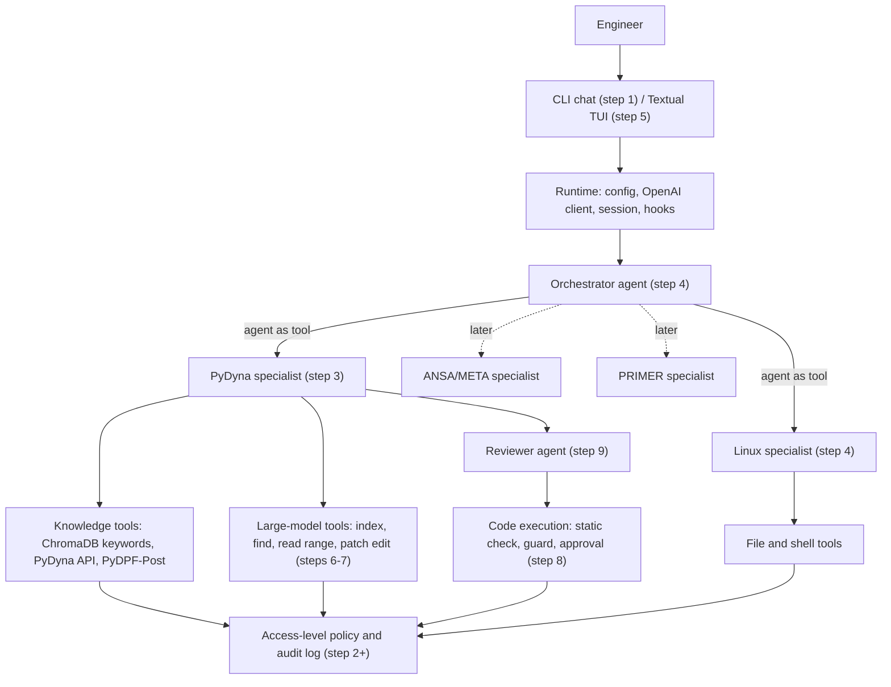

# Champion - Project Report

Author: Manoj Malavkar. Repository: https://github.com/ManojMalavkar/Champion

This report is updated at the end of every build step. It is written to be presented: summary first, then architecture, decisions, safety, progress with evidence, a demo script and likely questions.

**Status:** steps 0 and 1 of 12 (steps 0-11) built: configuration and health check, first agent with a tool in a plain chat. 56 automated tests passing.

---

## 1. Summary

Champion is a multi-agent assistant for CAE (crash simulation) engineers. It answers LS-DYNA and PyDyna questions from a curated knowledge base, inspects and edits very large LS-DYNA models (mostly over 1 GB) without loading them whole, and runs generated PyDyna code only after review and user approval. It also helps with Linux tasks on the engineer's workstation.

It is a rebuild of my earlier projects, mChampion (a Textual terminal UI multi-agent assistant) and PyDyna_Agent (an LS-DYNA copilot with retrieval over ChromaDB), on the **OpenAI Agents SDK**. The goal is a cleaner architecture, a stronger safety model and a design that can take further CAE specialists (ANSA/META, PRIMER) without core changes.

## 2. Problem

* **Knowledge:** LS-DYNA has thousands of keywords with strict card formats; general LLM answers often invent parameter names or defaults.
* **Scale:** production models and their include files are often 1 to 8 GB; they cannot be pasted into a model or rewritten in one go.
* **Safety:** an assistant that reads, edits and runs code on an engineer's machine must not touch files outside what the user allowed, must not leak secrets, and must not run code that does something other than what was asked.
* **Growth:** the same assistant should later cover pre-processing tools (ANSA/META Python API, Oasys PRIMER automation).

## 3. Architecture

Built so far: CLI chat, runtime, one agent with one tool (`session_info`). The rest is planned in this order.

Key idea: **specialists are tools, not handoffs.** The orchestrator calls `pydyna_agent` or `linux_agent` like a function and gets an answer back; it never gives up control. Each low-level tool belongs to exactly one specialist, so for example only the PyDyna agent can edit a model.

## 4. Key design decisions

| Decision | Choice | Why | Alternative considered |
| --- | --- | --- | --- |
| Agent framework | OpenAI Agents SDK | Small API (Agent, Runner, function_tool), built-in sessions, hooks, guardrails, typed outputs, tool approval | Hand-written loop (mChampion), LangGraph |
| Multi-agent pattern | Agents as tools | Orchestrator keeps control and context; each specialist has a narrow tool set; easy to test | Handoffs (control moves to the specialist, harder to keep policies central) |
| Model access | Direct OpenAI key, one client | Simple for phase 1; `base_url` allows a company gateway later | Several gateway backends (as in mChampion) |
| Access control | Five levels chosen by the user (1.1, 1.2, 2.1, 2.2, Custom) | Clear to explain: where (working folder or outside) x what (read or read/write) | mChampion's six behaviour-based levels |
| Large models | Keyword-offset index, ranged reads, patch edits | Constant memory on 1-8 GB decks; the model only ever sees small blocks | Loading the deck with PyDyna `Deck` (too slow and memory-hungry) |
| Code execution | Host run after reviewer + static check + approval + runtime guard | No container needed in phase 1; layered defence | Bubblewrap sandbox (planned as a later backend) |
| Extensibility | Specialist plug-ins with a declared spec | ANSA/META and PRIMER added without touching orchestrator, policy or UI | Hard-coded routing |
| Build process | 12 small steps, each tested, documented and committed | Every step can be demonstrated and understood | Big-bang rewrite |

## 5. Safety model

| Layer | Purpose | Status |
| --- | --- | --- |
| Secrets handling | Key read from environment or `.env`, never printed, not copied into the process environment; online check reports error type only | Done (step 0), tested |
| Tracing | SDK traces off by default (would send content to OpenAI) | Done (step 1) |
| Turn limits | `max_turns` stops a looping agent; history limited to the last 10 turns | Done (step 1), tested |
| Access levels | Every file tool checks the level in the run context (the model cannot change it); secrets, keys, symlinks, `/proc`, `/sys`, `/dev` always blocked | Step 2 |
| Tool ownership | Write and execute tools exist only on the specialist that needs them | Step 4 |
| Large-file limits | 100 MiB threshold for large-file mode, hard size limit | Step 6 |
| Edit approval | Diff shown, user approves, undo available | Step 7 |
| Code review | Reviewer agent checks policy and intent; approval tied to the exact code hash | Steps 8-9 |
| Audit | Every tool call recorded | Hooks in step 1, stored from step 5 |

## 6. Progress log

### Step 0 - Skeleton, configuration, `champion doctor`
* **Built:** package layout, configuration loader (defaults + YAML, validation of every key, path resolution), `champion doctor` health check (OK/WARN/FAIL for Python, config, key, packages, paths, optional online check).
* **Evidence:** 40 tests; `champion doctor` output shows the expected failures before setup.
* **Lessons:** validate configuration once, at start, with all errors listed together; keep secrets out of the environment so child processes (code execution later) cannot inherit them.

### Step 1 - First agent in a plain chat
* **Built:** runtime (one OpenAI client, model, tracing off, session memory limited to 10 turns, turn limit), the first agent with one read-only tool `session_info`, run hooks that print every tool call, `champion chat` with `/help`, `/new`, `/usage`.
* **Evidence:** 56 tests (16 new) using a scripted fake model - no network, no cost, repeatable. Tests check the real SDK loop: the tool result goes back to the model, history is kept and trimmed, `/new` forgets, a looping agent is stopped. With an invalid key the real client reached OpenAI and the error was shown as one line (`AuthenticationError (HTTP 401)`), without key text.
* **Lessons:** the SDK replaces the hand-written tool loop from the course (lab 3) with `Runner.run`; the run context carries trusted data (like the access level) that tools use but the model never sees.
* **Issue solved:** `openai-agents` 0.24 needs `openai` 3.x, while `langchain-openai` 1.4 (course labs) needs `openai` 2.x. Solution: a dedicated virtual environment for Champion, documented in the README.

## 7. Metrics

| Step | Tests (total) | Main new modules | Commit |
| --- | --- | --- | --- |
| 0 | 40 | `core/config.py`, `doctor.py`, `cli.py` | Step 0 |
| 1 | 56 | `core/runtime.py`, `core/context.py`, `core/hooks.py`, `agents/assistant.py`, `tools/session_info.py`, `chat.py` | Step 1 |

## 8. Demo script (current state)

About 5 minutes. Run from the project folder with the virtual environment active.

1. `champion --version` and `champion doctor` - show the health table and that the key is "found (value not shown)".
2. `pytest -q` - 56 tests pass in a few seconds without calling OpenAI.
3. `champion chat`:
   * "What is my access level and which folder am I in?" - point out the `-> session_info({})` line: the agent decided to call a tool instead of guessing.
   * "My name is Manoj", then "What is my name?" - session memory; `/new` and ask again - forgotten.
   * "List the files here" - the agent says it cannot yet, instead of inventing a listing.
   * `/usage` - token usage for cost awareness.
4. Open `docs/steps/01-first-agent.md` and `champion/core/runtime.py` - explain Agent vs. Runner and the run context.

This section grows with each step (for example step 2: show a blocked read outside the working folder at level 1.1).

## 9. Testing approach

* **Fake model:** `tests/fake_model.py` implements the SDK model interface with scripted replies, so agent behaviour (tool calls, history, limits, errors) is tested without network or cost.
* **Security tests:** the key never appears in output or results; invalid configuration is rejected; API errors are shown without their message text.
* **Sync tests:** the example configuration must match the built-in defaults exactly.
* **Each step:** all earlier tests must still pass before a commit.

## 10. Limitations and next steps

* Not yet verified end to end with a real model answer (needs the key on the Linux machine).
* No file access yet; access levels are configured but enforced from step 2.
* Next: step 2 (access levels and file tools), then the PyDyna specialist (step 3) and the orchestrator (step 4).
* Later: ANSA/META and PRIMER specialists, a sandboxed execution backend, a company gateway via `llm.base_url`.

## 11. Likely questions

* **Why the OpenAI Agents SDK and not LangGraph?** Smaller surface for this use case: the main need is tool calling with strict control, which `Agent`, `Runner`, hooks, guardrails and tool approval cover directly. Graph orchestration is not needed because the orchestrator delegates to specialists as tools.
* **Why agents as tools instead of handoffs?** The orchestrator keeps the conversation and the policy in one place, and each specialist only gets the tools it needs. With handoffs, control and context move to the specialist.
* **How do you stop the model from reading files it should not?** The access level lives in the run context, which the model cannot see or change; every file tool checks it before acting, and some paths are always blocked. The model's request is treated as untrusted input.
* **How do you handle 1 GB+ models?** An index of keyword positions, built once by streaming; the model asks for outlines, searches and small ranges; edits are exact-text patches applied by streaming to a new file and swapping it in.
* **How do you test an LLM application?** Deterministic tests with a scripted fake model for all logic around the model; a small number of manual or online checks for real model behaviour.
* **What would you do differently in production?** A sandboxed execution backend, a company gateway instead of a direct key, central audit storage and evaluation sets for answer quality.
