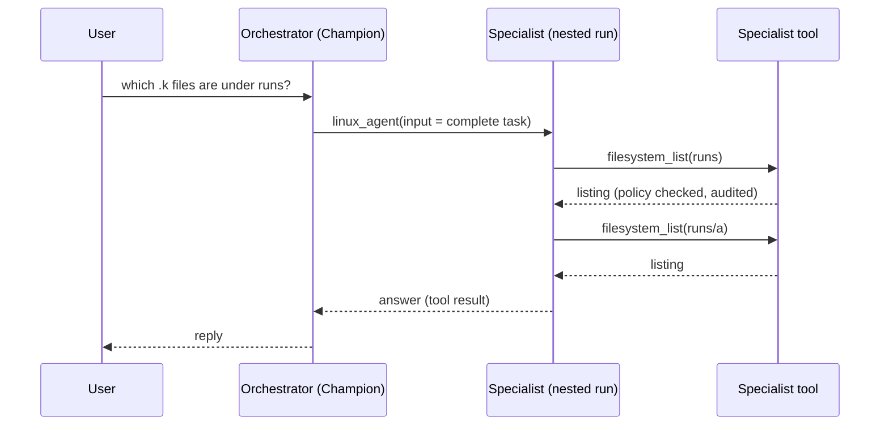

# Step 3 - Orchestrator and specialist plug-in interface

Goal: Champion becomes a multi-agent system. The main agent (the orchestrator) can call specialist agents, each with its own instructions and its own tools, and a new specialist can be added without changing the orchestrator, the runtime or the chat.

No real specialist is shipped yet: the Linux specialist comes in step 4 and the PyDyna specialist in step 5. This step builds and tests the interface with a dummy specialist.

## Pattern: agents as tools

* Each enabled specialist becomes one orchestrator tool `<name>_agent`, built with the SDK's `Agent.as_tool`.
* Calling it starts a **nested run**: the specialist's own instructions, only its own tools, the same run context (so the same access level and audit log), and its own turn limit.
* The specialist's final answer comes back as the tool result. The orchestrator keeps the conversation and writes the reply. No handoffs: control never leaves the orchestrator.
* The specialist sees only the task text, not the conversation, so the orchestrator is told to send a complete, self-contained task.

## Files

| File | What it does |
| --- | --- |
| `champion/specialists/base.py` | `SpecialistSpec`: name (config key `agents.<name>.enabled`, tool name `<name>_agent`), title, description (when to call it), instructions, tools, routing hints, enabled by default, max turns |
| `champion/specialists/registry.py` | `register_specialist`, `check_spec`, `select_specialists(config)` (config switch plus checks; problems are reported) |
| `champion/agents/orchestrator.py` | Orchestrator instructions (with a list of specialists and their routing hints), `build_specialist_tool` (as_tool, policy entry, guard, audit, nested hooks, tracing off, error text), `build_orchestrator` |
| `champion/core/hooks.py` | `SpecialistHooks`: nested tool calls are forwarded to the current turn's recorder |
| `champion/tools/guard.py` | `run_guarded_async` for async work (the specialist call); results starting with `ERROR:` are audited as errors |
| `champion/core/runtime.py`, `core/context.py` | Runtime builds the orchestrator from the registry; context holds the offered specialists and the current recorder |
| `champion/chat.py` | Banner lists the specialists and warns about rejected ones; tool calls inside a specialist are indented and named, e.g. `[Linux] -> filesystem_list(...)` |
| `champion/tools/session_info.py` | `specialists_available_now` lists the offered specialists |
| `tests/test_specialists.py` | 19 contract tests with a dummy specialist |

## Safety rules for specialists

1. **Deny by default:** a specialist is not offered if any of its tools has no tool-policy entry (or the spec is invalid). The chat shows a warning with the reason.
2. **Narrow tool sets:** the specialist gets only the tools in its spec; the orchestrator does not get them.
3. **Same checks everywhere:** tools inside a specialist run through the same guard, with the same access level. A level change with `/level` applies to the specialist at once.
4. **Audited twice:** one row for the specialist call (agent `Champion`) and one per tool call inside it (agent = the specialist's title).
5. **Tracing off** in the nested run as well.
6. **Clear errors:** the SDK's default error text ("An error occurred while running the tool. Please try again.") hides the reason and invites a retry. Champion returns `ERROR: specialist <title> used all N max turns ...` or the error type only, and tells the model not to retry the same task unchanged.
7. **Turn limit:** `orchestration.specialist_max_turns` (default 20), or `max_turns` in the spec.

## Adding a specialist (what step 4 will do)

1. Write the tools, each with `register(ToolRule(...))` and running through `run_guarded`.
2. Write a `SpecialistSpec` with a clear description and routing hints.
3. `register_specialist(spec)` in its module and import that module in `load_builtin_specialists()`.
4. Add `agents.<name>.enabled` to the example config.

No change to the orchestrator, runtime or chat.

## Evidence

* 134 tests pass (19 new), with the scripted fake model and no network. They check:
  * the spec checks and config switch;
  * that the orchestrator gets `dummy_agent` and the specialist only its own tools;
  * that the specialist gets the task, not the conversation;
  * the indented tool lines, the audit rows with agent names and the usage of nested calls;
  * that a level change reaches the specialist;
  * that a BLOCKED read inside the specialist is shown and audited, and the file text never reaches the model;
  * the turn limit with the clear error text.
* Live through the workspace AI Gateway with Claude Haiku 4.5 and a temporary specialist (not shipped):
  * the orchestrator sent "List all .k files under the runs folder and its sub-folders" to the specialist;
  * the specialist listed `runs`, then `runs/a`, and found `main.k` and `mat.k`;
  * 5 model requests; audit rows: 2 for the specialist's tool calls and 1 for the specialist call, all allowed.

## Learned

* `Agent.as_tool` is a nested `Runner.run`: it gets its own hooks, run config and turn limit, so all three must be set explicitly (the nested run does not see the main run's hooks).
* The run context object is shared with the nested run, which is what makes one access level and one audit log work across agents.
* Default error handlers in an SDK are written for generic use; for an agent, an error text must say what happened and whether retrying makes sense.
