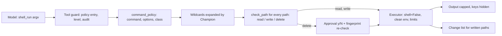

# Step 4a - Shared Linux tools and safe execution foundation

Goal: the tools the Linux specialist (step 4b) will use, and the safety layer under them. The model decides **what** to ask for; trusted Python decides **whether** it is allowed. No shell string is ever run.

No specialist is shipped in this step: the tools are tested on their own and through the tool guard with the fake model. Step 4b puts them on `linux_coder`.

## Tools

| Tool | Class | What it does |
| --- | --- | --- |
| `filesystem_find` | read | Name patterns (`*.k`), type, size (`"100M"`), age, sort (name/size/modified), limit (default 200, max 500) |
| `filesystem_grep` | read | Plain text (default, so `*MAT_024` works as typed) or a regular expression; file, line number, line. Skips binary files, files of 100 MiB or more, private keys, non-LS-DYNA `.key` files |
| `disk_analysis` | read | Largest folders (including sub-folders) and files; hard links counted once |
| `process_list` | read | Processes by memory or CPU from `/proc`; own user by default; command **name** only (arguments can hold secrets) |
| `file_edit` | write | Replace one exact block in a text file of any size (streaming); diff shown; undoable |
| `files_organize` | write | Create folders, move or rename as one checked plan; never overwrites or deletes; undoable |
| `shell_run` | by command | One allowed command as an argument list |
| `shell_pipeline` | read | 2-5 read commands connected by pipes, without a shell |

The find, grep and disk tools share `champion/tools/walk.py`: folders are opened relative to their parent with `O_NOFOLLOW` (a folder swapped for a link during the walk is refused), links are listed but never followed, blocked entries (secret names, `.champion`, system folders) are skipped and counted, and the walk stops after about 10 s or 200,000 entries and says so.

## Command flow



## Command policy (`champion/execution/command_policy.py`)

* **Read** (every level): `ls find du df stat file head tail wc grep sort uniq cut diff md5sum sha256sum ps free uptime nproc lscpu nvidia-smi`.
* **Write** (1.2, 2.2, custom with write; no prompt; change list): `mkdir touch cp mv tar gzip gunzip chmod`.
* **Delete** (write level and the user's yes every time): `rm`. Never the working folder, the current folder or a parent.
* **Never** (with the reason shown): shells, interpreters (only trusted scripts in step 4c), `sudo su`, `env xargs nohup nice timeout setsid stdbuf`, network (`ssh curl wget nc rsync ...`), `dd mount chown crontab systemctl ln awk sed kill tee`, and the HPC scheduler commands (`squeue sbatch qsub ...`, for the later HPC agent).
* Unknown command or unknown option: blocked. Options must match exactly (GNU tools accept abbreviations such as `--compress` for `--compress-program`; Champion does not).
* Options refused with a reason: those that run programs (`find -exec`, `tar --to-command`, `sort --compress-program`), follow links (`-L`), delete (`find -delete`), read file lists (`--files0-from`, `md5sum -c`), wait forever (`tail -f`), show command lines (`ps -f`), or **read contents recursively without Champion's secret checks** (`grep -r`, `diff -r`): for those `filesystem_grep` is the safe tool.
* `chmod`/`mkdir -m`: no setuid, setgid or sticky bits. `tar`: dash form only, `-f` required, no remote archives, `-x` needs `-k` so nothing is overwritten.
* Wildcards in file arguments are expanded by Champion in the checked folder (last part only); secret names and hidden files are left out; a name starting with `-` gets `./`.

## Executor (`champion/execution/commands.py`)

* `shell=False`; the program is taken only from `/usr/bin` or `/bin`.
* Environment: `PATH=/usr/bin:/bin`, `LANG`/`LC_ALL=C.UTF-8`, `TZ`, an empty temporary `HOME`. Nothing else: no `DATABRICKS_TOKEN`, no `OPENAI_API_KEY`.
* Own process group; at `execution.timeout_seconds` (120 s) the group gets SIGTERM, then SIGKILL.
* `setrlimit`: CPU 300 s, memory 4 GiB, written file size `execution.max_command_file_bytes` (8 GiB, new key), no core dumps.
* Output read while running, kept up to `execution.max_output_chars`; private-key blocks and token-like strings are replaced before the text goes to the model.

## Writes, the change list and undo

* Writes at a write level run **without a prompt**. Every changed path goes into the session change list (table `changes` in the audit database): number, time, agent, tool, action, path, sizes, summary.
* The chat prints `Changed files this turn: N (see /changes)`. `/changes` lists newest first. `/undo` undoes the last tool call (a whole `files_organize` plan), `/undo N` one entry. `/new` keeps the list.
* `file_edit` undo is a reverse patch in `.champion/backups/<session>/` (mode 700/600), refused if the file's SHA-256 changed since the edit. `files_organize` undo moves back and removes the created empty folders. Shell writes are listed but have no undo yet.
* `.champion` is blocked for every agent tool, so no agent can change undo data (or, in step 4c, the trusted scripts).

## `file_edit` streaming

Two passes, memory about one 1 MiB chunk: scan (count all matches, across chunk borders, with line numbers) and write (copy to a temporary file, new text at the offset, `fsync`, check the file did not change, atomic `os.replace`). One match exactly; free disk space at least file + 5 %; up to `pydyna.max_model_bytes` (8 GiB); `old_text` up to 64 KiB, `new_text` up to 1 MiB; binary files refused; encoding (UTF-8 or Latin-1) and CRLF kept; on any error or timeout the temporary file is removed and the original is untouched.

## Approval

* Only deletes ask (process control will too, later). The prompt shows the command, the program path, the folder, the level, every affected path and a warning; the default is no.
* Fingerprint: SHA-256 of program, arguments, class, folder, level and paths. Taken when asking, taken again from a fresh check just before the start; any difference (for example a new file matching `*.tmp`) and nothing runs.
* `champion chat -q` has nobody to ask: deletes are refused. `execution.require_approval: false` refuses deletes too, it never auto-approves.

## Audit

One row per call with the expanded argument list, class, affected paths, approval fingerprint (short), exit code, timeout flag and output size; never the output. `file_edit` stores only the text sizes.

## Files

| File | What it does |
| --- | --- |
| `champion/tools/walk.py` | Safe folder walk (fd-based, no links followed, limits) |
| `champion/tools/search.py` | `filesystem_find`, `filesystem_grep` |
| `champion/tools/system.py` | `process_list`, `disk_analysis` |
| `champion/tools/text_patch.py` | Streaming scan and patch engine (also used by L3 model editing later) |
| `champion/tools/edit.py` | `file_edit`, `files_organize`, reverse-patch undo |
| `champion/tools/changes.py` | Change list helpers, backups, `/changes` text, `/undo` |
| `champion/tools/shell.py` | `shell_run`, `shell_pipeline` |
| `champion/execution/command_policy.py` | Command rules, option parser, path kinds, wildcards |
| `champion/execution/approval.py` | Approval request, fingerprint, `ask` |
| `champion/execution/commands.py` | Process executor |
| `champion/storage/audit.py` | `changes` table |
| `champion/chat.py` | y/N prompt, turn summary, `/changes`, `/undo` |
| `champion/policy/sensitive.py` | `.champion` always blocked |
| `champion/tools/guard.py` | Unexpected `OSError` becomes `ERROR: ...` |

## Known limits

* Time-of-check race: a command opens its paths itself, after Champion's check. The fd-based tools (`file_edit`, find, grep) do not have this gap; shell commands do. A sandbox backend later removes it.
* A recursive `cp -r` into an existing folder can follow links already inside that folder.
* Shell `find`, `ls -R` and `du` list names inside secret folders (names only, never contents).
* Shell writes have no undo; `file_edit` and `files_organize` do.

## Tests

`tests/test_find_grep.py` (12), `tests/test_system_tools.py` (3), `tests/test_edit_tools.py` (16), `tests/test_command_policy.py` (6), `tests/test_commands.py` (13), `tests/test_chat_changes.py` (3): 53 new, 188 in total. Highlights: `*MAT_024` found by line; `.env`, `.ssh`, `.champion` and links never entered; metacharacters stay plain text (no `pwned` file); the child environment has exactly 5 variables; a timeout kills the child of a child; a 40 MiB edit peaks under 8 MiB of Python memory; a delete with no answer, `n`, or a changed wildcard does not run.

## Try it

In step 4b these become chat requests. Until then, from Python:

```python
from champion.core.config import load_config
from champion.core.context import ChampionContext
from champion.storage.audit import AuditLog
from champion.tools.search import find_files, grep_files
from champion.tools.shell import run_shell

ctx = ChampionContext.from_config(load_config(), level="1.1", audit=AuditLog())
print(find_files(ctx, ".", ["*.k"], sort="size"))
print(grep_files(ctx, "*MAT_024"))
print(run_shell(ctx, ["du", "-sh", "."]))
print(run_shell(ctx, ["bash", "-c", "id"]))  # PolicyDenied: never run
```
