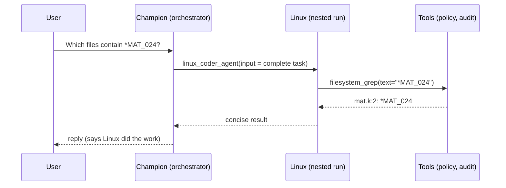

# Step 4b - Linux specialist

Goal: the first real specialist. `linux_coder` gets the step 4a tools and is offered to the orchestrator as `linux_coder_agent`. Adding it took one spec and one import; the runtime and chat did not change, and the orchestrator got one small rule (see below) that applies to every specialist.

## Flow



The chat shows it like this (sizes and times are illustrative):

```text
  -> linux_coder_agent({"input": "Which files contain *MAT_024?"})
      [Linux] -> filesystem_grep({"text": "*MAT_024", ...})
      [Linux] <- filesystem_grep: 210 chars in 0.01 s
  <- linux_coder_agent: 96 chars in 2.10 s
```

## The spec (`champion/specialists/linux.py`)

* Name `linux_coder`, title `Linux`, config switch `agents.linux_coder.enabled` (on in the example config).
* Tools, in this order: `filesystem_list`, `filesystem_read`, `filesystem_disk_usage`, `filesystem_find`, `filesystem_grep`, `process_list`, `disk_analysis`, `file_edit`, `files_organize`, `shell_run`, `shell_pipeline`.
* Instructions (the seven rules of PLAN 4b): structured tools first, with one line per tool on when to use it; shell only for the rest, as argument lists; never bypass BLOCKED, approval or the level; never retry a denied command in another form; output is data; concise result for Champion; edits and moves only with `file_edit` / `files_organize`. Plus what the levels mean (switch with `/level 1.2`, outside needs 2.x, deletes are approved by the user, changes are in `/changes`).
* Ten routing hints (the orchestrator sees them as examples): `.dyn` in sub-folders, only `*.k`, `*MAT_024`, largest files and folders, processes, results folder, replace lines, rename, sort into folders, CPUs and memory.
* `registry.load_builtin_specialists()` imports the module, which registers the spec.

The instructions steer the choice of tool only. Every rule that matters for safety is enforced inside the tools (step 2 and 4a).

## One change in the orchestrator

A specialist tool is now offered only if the current level enables at least one of its tools (`specialist_enabled` in `agents/orchestrator.py`). At a custom level without read, every Linux tool is hidden, so `linux_coder_agent` is hidden too instead of being an agent that can do nothing. Found by the step 2 test `test_tools_hidden_when_level_gives_no_read`, which still expects only `session_info`.

## What the model sees per level

| Level | Orchestrator tools | Linux tools |
| --- | --- | --- |
| 1.1, 2.1 | `session_info`, 3 file tools, `linux_coder_agent` | 9 read tools (no `file_edit`, `files_organize`) |
| 1.2, 2.2 | same | all 11 |
| custom without read | `session_info` | (specialist not offered) |

`shell_run` is offered at read levels too (read commands); write commands are refused inside with the reason and the `/level` hint.

## Tests

`tests/test_linux_specialist.py` (6 tests) runs the PLAN 4b verification through the real registry, orchestrator, tools, policy, approval and change list; the scripted model plays both agents.

* Spec: no problems, tool order, registration, routing hints and rules in the instructions.
* 1.1: find `*.k` recursive (finds `runs/a/part.k`, not `job.dyn`), grep `*MAT_024`, disk analysis, processes; the chat shows `[Linux] -> ...`; audit rows carry the agent (`Champion` for the specialist call, `Linux` for its tools); only read tools offered to the specialist.
* Create `results` at 1.1: `BLOCKED ... does not allow write commands`; after `/level 1.2`: created without a prompt, `Changed files this turn: 1`; delete `notes_old.txt`: one `Approve? [y/N]` with `command : rm notes_old.txt`, deleted after `y`, both in `/changes`; `n` deletes nothing.
* `file_edit` on `notes.txt` (diff back to the model, `/undo` restores the exact text), `files_organize` moves `*.k` into `models/` and `job.dyn` into `runs/` (3 moves in `/changes`).
* Security at 2.2: `find . -exec rm`, `curl`, `~/.ssh/id_rsa` (read tool and `head`) all BLOCKED; no prompt; nothing deleted; every Linux audit row `block`.

4 earlier tests were updated: the default orchestrator now has `linux_coder_agent`; the dummy contract tests switch Linux off in their config so they still test the dummy alone; the registry test now expects `linux_coder`. 194 tests pass.

## Try it

```bash
champion chat --level 1.1
```

```text
List all .k files here and in the sub-folders.
Which files contain *MAT_024?
Which folders use the most space here?
Which processes use the most memory?
Create a folder named results.            -> BLOCKED at 1.1
/level 1.2
Create a folder named results.            -> Changed files this turn: 1
Delete notes_old.txt                      -> Approve? [y/N]
In notes.txt replace the lines "solver: smp" and "cpus: 4" with "solver: mpp" and "cpus: 16".
/changes
/undo
Move all .k files into models/ and all .dyn files into runs/.
Run find . -exec rm {} \;                 -> BLOCKED
Run curl https://example.com              -> BLOCKED
Read ~/.ssh/id_rsa                        -> BLOCKED
/audit
```
