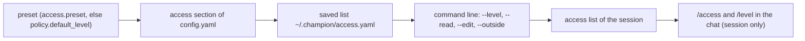

# Step 4e - Per-folder access (read or edit per folder)

Goal: replace the five fixed access levels with one access list the user controls: the working folder, any number of folders, and a setting for everything else, each with `none`, `read` or `edit`. The old levels stay as presets, so nothing the user knew stops working. The model can still not see or change the list.

## The access list

```text
Access 1.1 + 2 folders (this session)
  #  folder                     right
  W  /data/work      (working)  read
  1  /data/models               read
  2  /scratch/runs              edit
  *  everything else            none
```

* Rights: `none` (blocked), `read`, `edit` (read and change). `edit` includes delete, and a delete still asks `Approve? [y/N]` every time.
* The longest matching folder wins, so a folder can widen (`edit` inside a `read` folder) or narrow (`none` inside a readable outside) its parent.
* Fixed blocks always win over any entry: `/proc`, `/sys`, `/dev`, `/root`, secret-looking names, OS folders never edited, and Champion's own folder (`~/.champion`, which holds the saved list).
* The user-facing word is **edit**. `write` is still accepted as the old name in config files and tool rules.

## Presets (the old levels)

| Preset | Working folder | Everything else |
| --- | --- | --- |
| 1.1 (default) | read | none |
| 1.2 | edit | none |
| 2.1 | read | read |
| 2.2 | edit | edit |
| custom | from `policy.custom` (converted; `extra_dirs` become folders) | |

`/level NAME` applies a preset and **keeps** the folders. The banner shows `1.1 + 2 folders` when folders are listed.

## Where the starting list comes from



Later wins. The saved list replaces the folders from the config. A folder that no longer exists, or became a link, is skipped with a warning in the banner, so one moved folder does not stop Champion from starting. A saved file that is a link or can be changed by other users is not used.

## In the chat

```text
/access                         show the list
/access add PATH read|edit|none add a folder (or change the right of a listed one)
/access set N read|edit|none    change folder N
/access remove N                remove folder N
/access outside none|read|edit  everything else
/access working read|edit       the working folder
/access preset 1.1|1.2|2.1|2.2  start again from a preset (folders kept)
/access save                    keep the list for the next start (shows a diff)
```

* Changes are for the session only until `/access save`, which writes `access.file` (default `~/.champion/access.yaml`, mode 600, folder 700, atomic, never through a link). `access.file: null` turns saving off.
* Folders are checked when added: they must exist, must not be links (parents are resolved), and must not be system or secret folders; `edit` is also refused for OS folders like `/etc`.
* Edit access that reaches very far (`/`, the home folder, a parent of the working folder, or everything else) asks `Continue? [y/N]`; Enter means no.
* Every accepted change, including `/level`, is one audit row (`tool` `/access`, agent `user`). Refused changes leave the list as it was.
* `champion chat -q` has no `/access`; use the command-line options.

## On the command line

```bash
champion chat --level 1.1 --read /data/models --edit /scratch/runs --outside none
champion access list
champion access add /data/models read
champion access remove /data/models        # or the number from the list
champion access outside none
champion access working edit
```

`--read`, `--edit` and `--outside` are for that chat only. `champion access ...` changes the saved file and prints the diff.

## BLOCKED messages name the fix

```text
<- file_edit: BLOCKED: /data/models/car.k is read only (folder 1, access 1.1 + 2 folders);
   editing is not allowed there (the user can change it with /access set 1 edit)
<- filesystem_read: BLOCKED: /home/me/other/o.k is outside the working folder /data/work and the
   user's folders; access 1.1 + 2 folders gives everything else 'none', so reading is not allowed there
   (the user can add the folder with /access add PATH read, or choose level 2.1 / 2.2)
```

The agent reports this to the user; it has no tool to change access.

## Code

* `champion/policy/access.py` (new): `AccessLevel` (working right, outside right, folders), `entry_for` / `right_for` (longest match), `with_folder`, `with_folder_right`, `without_folder`, `with_preset`, `check_folder`, `is_wide`, presets, `from_legacy_custom`, `load_saved`, `save`, `build_access`.
* `champion/policy/levels.py`: now only re-exports the presets.
* `champion/policy/scope.py`: `check_path` uses `entry_for`; rights `read` and `edit`.
* `tool_policy.py`, `guard.py`, `edit.py`, `changes.py`, `execution/command_policy.py`: the right `write` is now `edit`; `requires("edit")` hides edit tools when no entry allows edit.
* `champion/core/context.py`, `core/runtime.py`: the context holds the list, `access_file` and start warnings; `set_level` applies a preset and keeps folders; `set_access` records the audit row.
* `champion/access_commands.py` (new): `/access` and `champion access`, shared by chat and CLI (the TUI in step 6 will call the same functions).
* `champion/chat.py`, `champion/cli.py`, `champion/core/config.py`, `config/config.example.yaml`: commands, options, the `access` section and its validation.

## Tests

`tests/test_folder_access.py` (15 tests):

* Presets give exactly the old level results (inside/outside x read/edit; `write` still works as the old name).
* Nested folders both ways, `none` inside a readable outside, longest match, 50 folders, changing a listed folder instead of adding it twice.
* Adding refuses missing folders, links, secret and system folders, and `edit` for `/etc`; a link inside a read folder pointing into an edit folder is refused.
* Fixed blocks win at 2.2 (`~/.champion/access.yaml`, `/etc/hosts`).
* The step 4a tools obey the list: `file_edit` refused in the read working folder, `cp` into a read folder refused, `cp` into an edit folder runs and is listed, `rm` there still asks once, `rm` in a read folder is refused before any prompt.
* `/access` add, set, remove, outside, working, preset; refusals leave the list unchanged; `/level` keeps folders; 7 audit rows with agent `user`; save is off in tests.
* Wide edit asks and defaults to no; read on a wide folder does not ask.
* Save writes mode 600 only on `/access save`, a restart loads it, a file others can write is not used, a moved folder is skipped with a warning.
* Config `access` section (`write` -> `edit`), clear validation errors, old `policy.custom` converted.
* `champion access add/list/remove` and the chat options; no tool rule contains "access"; help and BLOCKED messages say "edit".

7 older assertions changed from "write" to "edit" wording, and one chat test now ignores the `/level` audit row when counting tool calls. On Databricks serverless: 208 passed; the doctor exit-code test needs `textual` and runs on the local machine (see "Pending local checks" in `PLAN.md`).

A scripted chat of the PLAN 4e.7 check also passed: read in the read folder, edit there BLOCKED with the `/access set 1 edit` hint, `mkdir` in the edit folder listed in `/changes`, another folder BLOCKED, `/access save` with diff, restart shows the same list.

## Try it

```bash
champion chat --level 2.1
```

```text
/access add /data/models read
/access add /scratch/runs edit
/access outside none
/access
Show the start of /data/models/car.k                -> works
In /data/models/car.k replace "*END" with "*END\n"  -> BLOCKED, hint /access set 1 edit
Create a folder /scratch/runs/results               -> Changed files this turn: 1
Read /home/me/notes.txt                             -> BLOCKED (everything else none)
/access add ~ edit                                  -> Continue? [y/N], Enter = unchanged
/access save
/exit
champion chat
/access                                             -> same list
```
